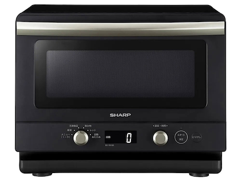
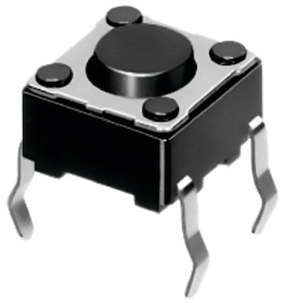
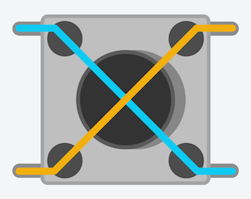

<!-- _class: cover -->

<h1 class="logo"><b>CODE</b>_OF_THINGS #2</h1>
<p class="title">コード・オブ・シングス :: コードでモノを動かす #2</p>
<p class="author">&copy; 2026 Satoshi Soma</p>

---

# 入力 

---

<!-- _class: small -->

<div class="cols c23 gap">
<div>
<figure>

</figure>
</div>
<div>

一般的に、電子機器は何らかの**入力インターフェース**を備えていることが多い。例えば電子レンジなら:

- 温めをスタートするボタン
- 温めを停止するボタン
- 温め時間や温度を設定するボタン、またはダイヤル

などを備えている。
ユーザーはこれらのインターフェースへの入力を介して機器に自分の*意図*を伝える。

</div>
</div>

---

これに対し機器側が行うべきことは、大まかに言うと以下の 3 点である。

1. 入力を**検知**する
2. 入力された情報を**処理**する
3. 入力に対して期待される**出力**を返す

<hr>

これらを可能にするために、電子機器の中でマイコンが具体的にどのような働きをしているのか、
Arduino で実践しながら学んでいこう。

---

<div class="cols c23 gap">
<div>
<figure></figure>
</div>
<div>

## ボタン入力の検知
**タクトスイッチ <small>(Tactile Switch)</small>** という部品を使って、物理ボタンの入力検知を行ってみよう。

</div>
</div>

---

<!-- _class: small -->

<div class="cols c23 gap">
<div>
<figure>

<figcaption>ボタン押下時の導通ライン</figcaption>
</figure>
</div>
<div>

タクトスイッチには 4 本の金属製の*脚<small>（ピン）</small>* が付いており、
それぞれが電極として機能する。

通常、4 本のピンは**互いに導通していない**。
各自が孤立した電極ということだ。

しかしボタンを押すと、押している間は**対角線上のピン同士が互いに導通**した状態になる。

</div>
</div>

---

Arduino とタクトスイッチをブレッドボードを介して接続してみよう。
今回は `D2` ピンをスイッチの入力検知に使用する。

まず、以下のように回路を組む。

```
D2 ➔ タクトスイッチ ➔ GND
```

**ボタンを押した時のみ `D2` が `GND` へ繋がる**ようにすること。

---

次はコードを書こう。
`setup()` で `D2` ピンを**入力モード<small>（プルアップ抵抗付き）</small>** に設定する。 

```c
const int btn_pin = 2; // D2 ピンを使用

void setup() {
  pinMode(btn_pin, INPUT_PULLUP); // D2 を入力モードにする（プルアップ抵抗）
}
```

これにより、スイッチのボタン押下状態を **`D2` ピンの電圧変化**という形で検知できるようになる。

---

デジタルピンの電圧を読むには `loop()` 内で **`digitalRead(ピン番号)`** という関数を使う。

```c
void loop() {
  int vol = digitalRead(btn_pin); // 電圧を取得
}
```

この関数は、指定されたピンの電圧が、

- 高い状態なら `HIGH`
- 低い状態なら `LOW`

を返す。

---

この回路では、

- ボタンを*押していない*間は `D2` が *`HIGH`*
- ボタンを*押している*間は `D2` が *`LOW`*

になる。

つまり、`digitalRead()` で取得した値が `HIGH` か `LOW` かを*判定*することで、
**ボタンの押下状態を知る**ことができるというわけだ。

---

<!-- _class: small -->

判定にはもちろん、**`if` 文**を使う。

```c
void loop() {
  int vol = digitalRead(btn_bin); // 電圧を取得
  if (vol == HIGH) { // 押していない時
    
  } else { // 押している時
    
  }
}
```

変数宣言を省略して、このように書くこともできる。

```c
void loop() {
  if (digitalRead(btn_bin) == HIGH) { // 押していない時
    
  } else { // 押している時
    
  }
}
```

